| Name           | NRP        | Kelas     |
| ---            | ---        | ----------|
| Muhammad Hilman Azhar | 5025241264 | Jarkom B |

> [!IMPORTANT]
> Remember to use the IP prefix allocation provided earlier for this pre-lab assignment (pra-praktikan) and for future ones.
> Access it on [Linktree](https://linktr.ee/jarkom) 


> [!NOTE]
> Praktikum Modul 2 / Module 2 Practicum (Remedial): HTTP Server, DNS Server, dan Reverse Proxy.
>
> Original practicum file document: [here](https://docs.google.com/document/d/1fn0ws-wI6X9SqzrOTLM7Xz7O1uBz8M1k/edit?usp=sharing&ouid=109083087274352750540&rtpof=true&sd=true)

## Put your GNS3 Project file here (gdrive or github upload)!

[modul2-remedial.gns3project](./modul2-remedial.gns3project) (File → Import project di GNS3)

## Topology

> [!IMPORTANT]
> Create the topology **from scratch**; you may not reuse the topology from the pra-praktikum.
>
> **Put your topology image (PNG/JPEG) here, before continuing to the tasks below!**

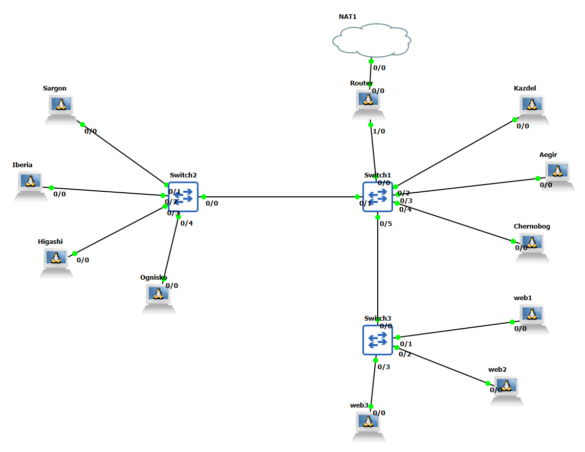

IP prefix yang saya pakai: **10.92**, semua node ada di subnet `10.92.200.0/24`.

| Node | Peran | IP |
| --- | --- | --- |
| Router | NAT ke internet | eth0 DHCP (dari NAT1), eth1 `10.92.200.1` |
| Aegir | DHCP Server (udhcpd) | `10.92.200.10` |
| Kazdel | Reverse Proxy (nginx) | `10.92.200.11` |
| Chernobog | DNS Server (BIND) | `10.92.200.12` |
| web1 / web2 / web3 | Backend nginx (port 8080) | `10.92.200.20` / `.21` / `.22` |
| Sargon, Iberia, Higashi, Ognisko | Client (DHCP) | pool `10.92.200.100–150` |

Semua konfigurasi saya taruh di `/root/init.sh` tiap node (folder `/root` dan `/etc` persistent), jadi otomatis jalan setiap node di-start.

---

#### Soal 1

> Koneksikan seluruh topologi agar bisa mendapat internet dari NAT (konfigurasi router, gateway dan DHCP Server)

> Configure the entire network topology to enable internet access via NAT (configure the router, gateway, and DHCP server).

**Answer:**

Router saya kasih 2 interface: `eth0` ambil IP dari NAT1 (DHCP), `eth1` jadi gateway LAN `10.92.200.1`. Di `/root/init.sh` saya nyalakan IP forwarding dan MASQUERADE supaya subnet `10.92.200.0/24` bisa keluar ke internet.

```sh
# Router - /root/init.sh
sysctl -w net.ipv4.ip_forward=1
iptables -t nat -A POSTROUTING -o eth0 -s 10.92.200.0/24 -j MASQUERADE
```

Node server (Aegir, Kazdel, Chernobog, web1-3) pakai IP statis dengan `gateway 10.92.200.1`. Aegir menjalankan `udhcpd` untuk client dengan pool `.100–.150` dan `option router 10.92.200.1`:

```
start 10.92.200.100
end 10.92.200.150
interface eth0
option subnet 255.255.255.0
option router 10.92.200.1
option dns 10.92.200.12
option domain sekolah.local
```

Client cukup `iface eth0 inet dhcp`. Hasilnya semua client dapat IP dari Aegir dan bisa ping internet.

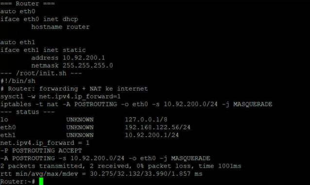
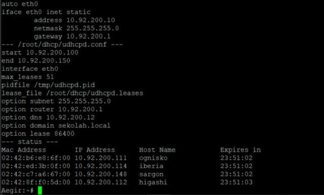

#### Soal 2

> Pasang DNS server internal dengan domain pilihan sendiri (misalnya sekolah.local) yang mengarah ke Kazdel, dan integrasikan dengan DHCP server agar seluruh PC lab (DHCP client) otomatis mengetahui alamat DNS ini.

> Set up an internal DNS server using a custom domain (e.g., sekolah.local) pointing to Kazdel, and integrate it with the DHCP server so that all lab PCs (DHCP clients) automatically recognize this DNS address.

**Answer:**

Domain yang saya pakai **`sekolah.local`**, di-host BIND di Chernobog (`10.92.200.12`). `sekolah.local` dan `www.sekolah.local` sama-sama mengarah ke Kazdel (`10.92.200.11`). Query di luar zona di-forward ke `8.8.8.8` jadi client tetap bisa resolve domain internet.

```
zone "sekolah.local" { type master; file "db.sekolah.local"; };
```
```
@    IN  NS  ns1.sekolah.local.
ns1  IN  A   10.92.200.12
@    IN  A   10.92.200.11
www  IN  A   10.92.200.11
```

Integrasi ke DHCP: di config udhcpd Aegir saya tambahkan `option dns 10.92.200.12` dan `option domain sekolah.local`. Jadi waktu client dapat lease, `/etc/resolv.conf`-nya otomatis berisi `nameserver 10.92.200.12` tanpa diisi manual.

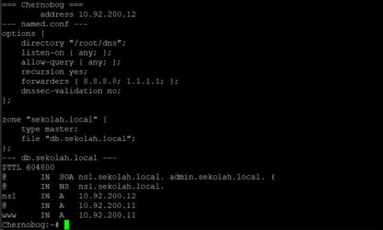
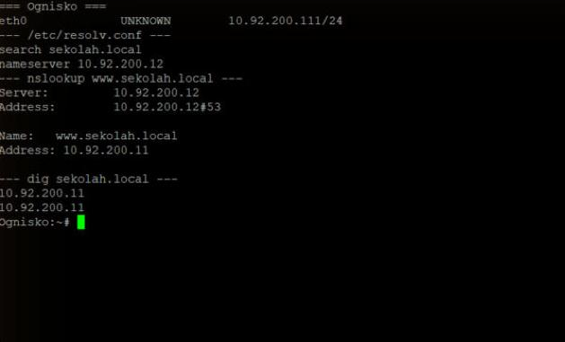
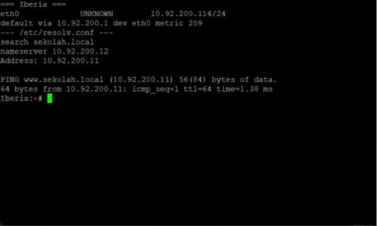
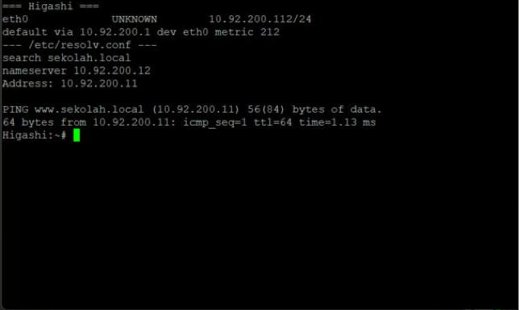

(resolv.conf Sargon ada di screenshot Soal 5)

#### Soal 3

> Jalankan tiga backend HTTP/aplikasi berbeda (nilai, absensi, kalender akademik) di tiga node berbeda (web1, web2 dan web3), menggunakan nginx.
> a. web1.html
> b. web2.html
> c. web3.html

[drive](https://drive.google.com/drive/folders/1c4rWJrtACG9G0XPTUFTabhSoq1JMveIf?usp=sharing) 

> Run three distinct HTTP backends/applications (grades, attendance, and academic calendar) on three separate nodes (web1, web2, and web3), using nginx.
> a. web1.html
> b. web2.html
> c. web3.html
> [drive](https://drive.google.com/drive/folders/1c4rWJrtACG9G0XPTUFTabhSoq1JMveIf?usp=sharing) 

**Answer:**

Tiap backend jalan nginx di port 8080 dengan file HTML dari drive: web1 = Nilai (`web1.html`), web2 = Absensi (`web2.html`), web3 = Kalender (`web3.html`). Saya tambahkan `allow 10.92.200.11; deny all;` supaya backend cuma bisa diakses dari reverse proxy, bukan langsung dari client.

```nginx
server {
    listen 8080;
    root /root/myweb;
    index web1.html;      # web2.html / web3.html di node lain
    allow 10.92.200.11;   # hanya Kazdel
    deny all;
}
```

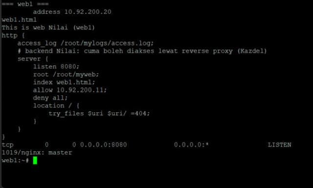
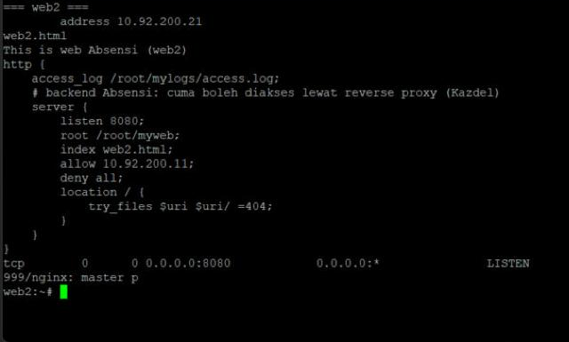
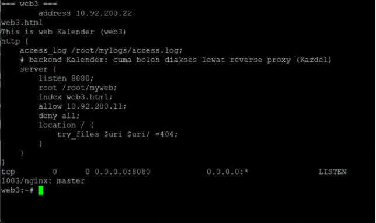

#### Soal 4

> Pasang satu reverse proxy yang bisa diakses lewat nama domain (misalnya www.sekolah.local), meneruskan /nilai, /absensi, dan /kalender ke masing-masing backend.

> Set up a reverse proxy accessible via a domain name (e.g., www.sekolah.local) that forwards requests for /nilai, /absensi, and /kalender to their respective backends.

**Answer:**

Reverse proxy ada di Kazdel (nginx port 80) dengan `server_name www.sekolah.local sekolah.local`. Tiap path diteruskan ke backend-nya:

```nginx
location = /nilai     { proxy_pass http://10.92.200.20:8080/; }
location /nilai/      { proxy_pass http://10.92.200.20:8080/; }
location = /absensi   { proxy_pass http://10.92.200.21:8080/; }
location /absensi/    { proxy_pass http://10.92.200.21:8080/; }
location = /kalender  { proxy_pass http://10.92.200.22:8080/; }
location /kalender/   { proxy_pass http://10.92.200.22:8080/; }
```

`/` sendiri menampilkan halaman index berisi link ke ketiga aplikasi. Di screenshot terlihat Kazdel bisa curl ketiga backend.

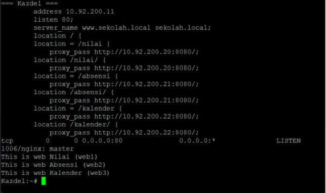

#### Soal 5

> Buktikan dari command line (curl) dan browser bahwa ketiga aplikasi dapat diakses lewat satu nama domain yang sama.

> Demonstrate using both the command line (curl) and a web browser that all three applications are accessible via the same domain name.

**Answer:**

**curl (Sargon):** ketiga path di `www.sekolah.local` mengembalikan halaman backend yang benar. Akses langsung ke backend (`10.92.200.20:8080`) ditolak `403`, jadi semua traffic memang lewat reverse proxy.

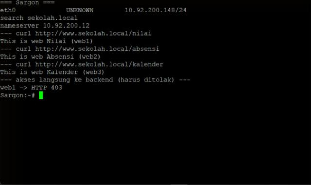

**Browser (Ognisko):** karena appliance `netics-pc-desktop` tidak tersedia di GNS3 saya, untuk Ognisko saya pakai browser teks `lynx` di `netics-pc`. Buka `http://www.sekolah.local/` lalu klik masing-masing link:

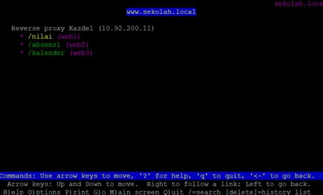
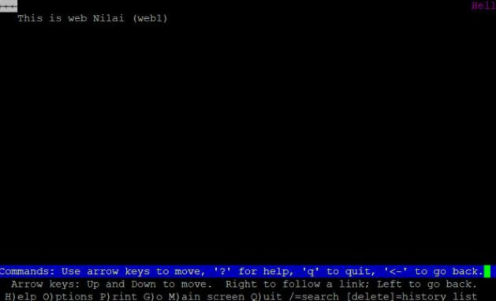
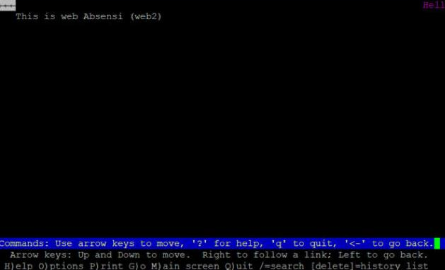
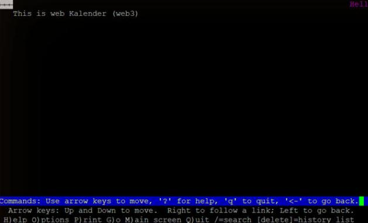

#### Soal 6

> Jelaskan pada asisten 2 pertanyaan berikut:
> a. Jelaskan bagaimana DNS, reverse proxy, dan backend saling bekerja sama sebagai satu sistem
> b. Serta apa yang terjadi bila salah satu komponen tidak berfungsi

> Explain the following two points to the assistant:
> a. Explain how the DNS, reverse proxy, and backends work together as a unified system.
> b. Explain what happens if one of the components fails to function.

**Answer:**

**a. Cara kerja sama sebagai satu sistem**

1. Client dapat IP + alamat DNS (`10.92.200.12`) dari DHCP Aegir.
2. Client akses `www.sekolah.local/nilai` → tanya ke DNS Chernobog → dijawab IP Kazdel (`10.92.200.11`).
3. Request HTTP dikirim ke Kazdel. Nginx di Kazdel lihat path-nya (`/nilai`, `/absensi`, `/kalender`) lalu meneruskan ke backend yang sesuai (web1/web2/web3 port 8080).
4. Backend balas ke Kazdel, Kazdel balas ke client. Client cuma tahu satu domain dan satu IP, alamat backend tersembunyi.

**b. Kalau salah satu komponen mati**

- **DNS (Chernobog) mati:** nama `www.sekolah.local` tidak bisa di-resolve, client gagal akses walaupun proxy dan backend jalan. Masih bisa lewat IP Kazdel langsung.
- **Reverse proxy (Kazdel) mati:** domain ter-resolve tapi koneksi ke port 80 ditolak/timeout, ketiga aplikasi tidak bisa diakses sama sekali (backend juga menolak client langsung).
- **Salah satu backend mati:** hanya path itu yang error (nginx kasih `502 Bad Gateway`), path lain tetap normal.
- **DHCP (Aegir) mati:** client baru tidak dapat IP/DNS, jadi tidak bisa ikut jaringan. Client yang sudah punya lease tetap jalan sampai lease habis.
- **Router mati:** jaringan lokal tetap jalan, tapi tidak ada akses internet (forward DNS ke luar juga gagal).
